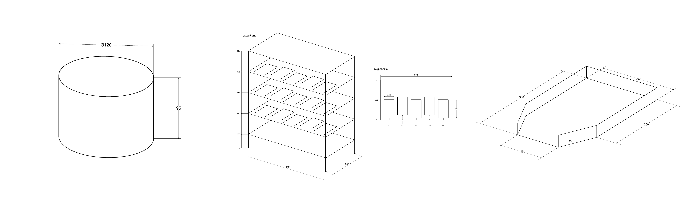

# Technical Redraw

Навык для Codex: перерисовывает эскиз или описание детали в чёрно-белый PNG с размерами. Если ракурс не указан, Codex его уточнит.



Скопируйте папку `technical-redraw` в каталог пользовательских навыков Codex. В новом чате приложите эскиз и напишите: «Используй $technical-redraw. Перечерти эскиз, вид сверху».

Чтобы проверить скрипт отрисовки, запустите из корня репозитория:

```sh
python -m pip install Pillow
python scripts/drawing.py --demo cup-preview.png
```
